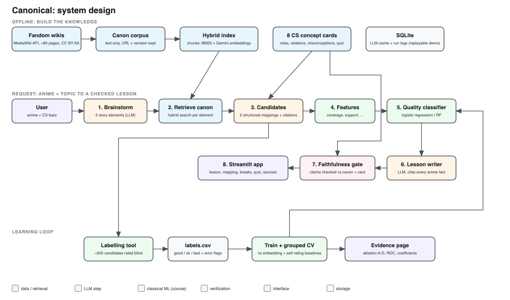

# Canonical

**Learn computer science through the anime you love, with every analogy checked.**

Ask a chatbot to teach recursion through Naruto and you get something that sounds great and is often wrong:
anime facts that never happened, and analogies whose structure does not match the concept (shadow clones have
no base case). Canonical generates analogy lessons from a real canon corpus. A classifier trained on hand
labels ranks the candidate analogies, and a faithfulness gate checks every claim. An ablation measures how
much each layer helps.

CUNY Tech Prep, Data Science track, Fall 2026. Solo project.

## How it works



1. **Canon corpus.** 82 Fandom wiki pages (about 400k words) for Naruto, Hunter x Hunter and Jujutsu Kaisen,
   pulled through the MediaWiki API. Text only, CC BY-SA, with URL and revision kept for attribution.
2. **Hybrid retrieval.** Pages are split into section-aware chunks, then searched with BM25 plus Gemini
   embeddings, fused with reciprocal rank fusion.
3. **CS concept cards.** 8 hand-checked JSON answer keys: stack, queue, recursion, BFS, DFS, hash table, binary
   search and deadlock. Each card lists roles, structural relations, misconceptions and a 5-question quiz.
4. **Candidates.** The LLM proposes 5 anime elements, then builds structured mappings with passage citations.
   Each mapping says which anime element plays each CS role and whether each relation holds.
5. **Features + classifier.** Explainable features feed a **logistic regression** and a **random forest**
   trained on hand labels. The features are role coverage, relation holds, citation validity, claim support,
   misconception similarity and the "breaks" statement. Both models are evaluated with grouped CV against an
   embedding-only baseline and the LLM's self-rating.
6. **Lesson + faithfulness gate.** The top analogy becomes a cited lesson. Every claim is extracted and
   verified against retrieved canon and against the CS card. Rejected claims trigger one rewrite, and anything
   still unsupported is flagged.

## Run it

```bash
cd canonical
uv venv .venv --python 3.11 && uv pip install --python .venv/bin/python -r requirements.txt
cp .env.example .env                     # paste your key from https://aistudio.google.com/apikey

.venv/bin/python scripts/fetch_corpus.py           # 1. canon corpus (run once after cloning; resumable)
.venv/bin/python scripts/build_index.py            # 2. chunks + embeddings
.venv/bin/python scripts/make_candidates.py --rounds 0 1   # 3. ~240 candidates to label
.venv/bin/streamlit run app/Home.py                # label them on the "Label" page
.venv/bin/python scripts/train_ranker.py           # 4. train + evaluate the classifier
.venv/bin/python scripts/run_ablation.py --samples 0 1 2   # 5. conditions A-D
.venv/bin/python scripts/eval_retrieval.py         # retrieval Recall@5 / MRR
.venv/bin/python -m pytest -q tests                # offline tests
```

Every LLM response is cached in `data/canonical.sqlite`, so reruns are free and showcase pairs work with no
network.

## Evaluation (filled from real runs only)

| Metric | A: plain prompt | B: + canon RAG | C: + card + ranker | D: + faithfulness gate |
|---|---|---|---|---|
| Unsupported canon claims (%) | | | | |
| CS contradictions per lesson | | | | |
| Relation coverage (%) | n/a | n/a | | |

Classifier ROC-AUC (grouped CV, 95% cluster-bootstrap CI): see the Evidence page. Retrieval BM25 baseline on 51
labelled queries: Recall@5 0.843, MRR 0.693. Dense and hybrid will be reported once embeddings are built.

## Data and licensing

- Wiki text: Fandom, CC BY-SA. Fetched once at low volume (about 1 request per second), attributed per passage,
  and not redistributed. No images, video, subtitles or character art are used anywhere.
- Anime names are the property of their rights holders. This is a non-commercial educational project.

## Honest limitations

- The fact-checker is itself an LLM. Its accuracy is spot-checked by hand and reported, not assumed.
- Labels come mostly from one rater (the author). A second rater's agreement (weighted Cohen's kappa) is
  reported on an overlapping subset.
- Any learning-gain result is a small pilot, not proof.
